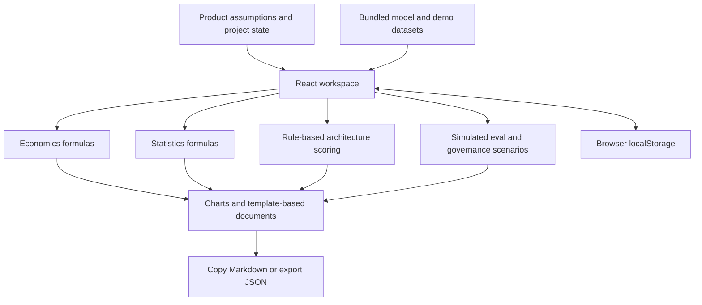

# Prism AI PM Toolkit

**A decision studio for AI product managers: architecture, model trade-offs, unit economics, evaluation planning, and experiments in one browser workspace.**

Start with a product constraint, compare options, and turn the decision into a copyable PRD and case study.

[Try the deployed demo](https://prismai.ai.studio/) · [Economics engine](src/utils/econEngine.ts) · [Statistics engine](src/utils/statsEngine.ts)

**Status:** Portfolio prototype built in Google AI Studio. Current workflows run in the browser and need no API key. Calculations are implemented; benchmarks, evaluation outcomes, and governance scenarios are illustrative.

## The product question

Which AI approach meets a feature's quality, latency, and budget constraints—and what would have to be true before shipping it? Prism connects those assumptions so a model choice can be discussed alongside operating cost, architecture, evaluation criteria, and release guardrails.

## Walkthrough: Order Dispute AI Copilot

The preloaded demo project provides a complete planning example:

1. **Unit Economics & ROI:** Adjust query volume, tokens, caching, retries, and human escalation. Inspect cost per successful task and monthly operating cost.
2. **Model Benchmark Matrix:** Apply latency/capability constraints, then adjust weights. The Pareto view uses bundled sample data, rather than live benchmarks.
3. **Architecture & PRD Builder:** Compare five implemented patterns: deterministic workflow with RAG/tools, model routing with RAG, hybrid RAG, structured outputs, and a tool-using agent. Copy the Markdown PRD.
4. **Golden Dataset & Regression:** Review cases and change human grades. Run the simulated batch suite to see how retrieval and guardrail settings change example outcomes.
5. **A/B Experiment Lab:** Set baseline, minimum detectable effect, traffic split, and statistical assumptions. Inspect sample-size estimates and example results alongside guardrails.
6. **Portfolio Case Study:** Record your reasoning and export JSON state. Review the generated narrative before sharing: its measurements and policy claims inherit simulated workspace assumptions.

This demonstrates a decision process. It does not establish that the example copilot has been deployed or tested with customers.

## What is real and what is simulated

| Area | Implemented | Interpretation and limits |
| --- | --- | --- |
| Economics | Formulas for tokens, caching, retrieval/tools, retries, human escalation, and ROI. | Estimates depend on inputs and static prices; they are not invoices or measured savings. |
| Statistics | Sample-size planning, two-proportion tests, continuous comparisons, and sample-ratio mismatch checks. | Continuous comparisons use an approximate Welch-style calculation. Validate assumptions against a reference statistics implementation. |
| Architecture | Five rule-scored patterns and template-based Markdown. | Heuristic recommendations; fit scores are not probabilities and can exceed 100. |
| Models | Filtering, weighted scores, and Pareto comparisons. | Prices, IDs, latency, quality, and capabilities in [`models.ts`](src/data/models.ts) are hand-built; no live sync. Verify current provider availability and pricing before budgeting. |
| Evals | Case editing, PASS / FAIL / REVIEW tracking, batch-run UI. | Outcomes, faithfulness/retrieval metrics, and trends use preset rules/sample data. No retrieval or model evaluation executes. |
| AI PM Copilot | Workspace-based templates and checks for conflicting budget, latency, and quality assumptions. | No LLM generation. The session-key UI and “Gemini Active” indicator do not activate model calls in the current source. |
| Agents and security | Policy, escalation, role, DLP, and audit-log scenarios. | No real tools, enforced backend RBAC, DLP service, tamper-proof log, or compliance certification. |
| State and exports | Browser `localStorage`, Markdown, JSON export, and a decision log. | Data can be changed or cleared; the log is not immutable or shared. |

The **Verification Math Tests** tab checks selected formulas against known values. It is an implementation check, rather than independent validation of business outcomes or all statistical edge cases.

## Architecture



React, TypeScript, Vite, Tailwind CSS, and Recharts. The current app has no application backend or live model integration.

## Run locally

Checked with Node.js 24 and npm 11. The current manifest has a Vite/esbuild peer conflict; skipping peer resolution also leaves Recharts' `react-is` peer missing. This temporary local install gets the existing source running without changing dependency files:

```bash
git clone https://github.com/aaryanvani-PM/Prism-AI-PM-toolkit.git
cd Prism-AI-PM-toolkit
npm install --legacy-peer-deps --no-save --package-lock=false react-is@19
npm run dev
```

Open `http://localhost:3000`. No `.env` file or API key is needed for implemented workflows. Use sample inputs when exploring the key/security configuration UI.

```bash
npm run lint    # TypeScript check
npm run build   # Static frontend bundle
npm run preview # Preview the built frontend
```

## Product decisions and next evidence

TypeScript and the frontend build passed with the install workaround above. Repairing the dependency manifest/lockfile remains follow-up work.

- **Cost per successful task:** Include human review and retries alongside inference cost. Compare different success-rate and escalation assumptions.
- **Constraints before ranking:** Exclude a model that fails a required capability before applying preference weights.
- **Guardrails alongside lift:** A conversion gain is insufficient if quality regresses.

Next steps are versioned live evaluation results, a real model adapter, and statistical validation against a reference library. Until then, pass rates and projected ROI remain scenario outputs.

Start with [`App.tsx`](src/App.tsx) for architecture rules and batch simulation, [`econEngine.ts`](src/utils/econEngine.ts) and [`statsEngine.ts`](src/utils/statsEngine.ts) for calculations, and [`CopilotTab.tsx`](src/components/CopilotTab.tsx) for templates.
